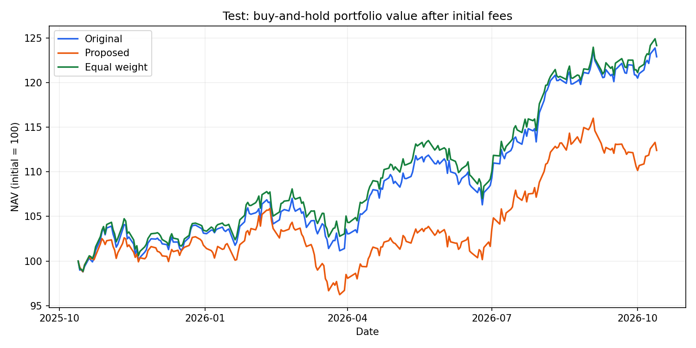
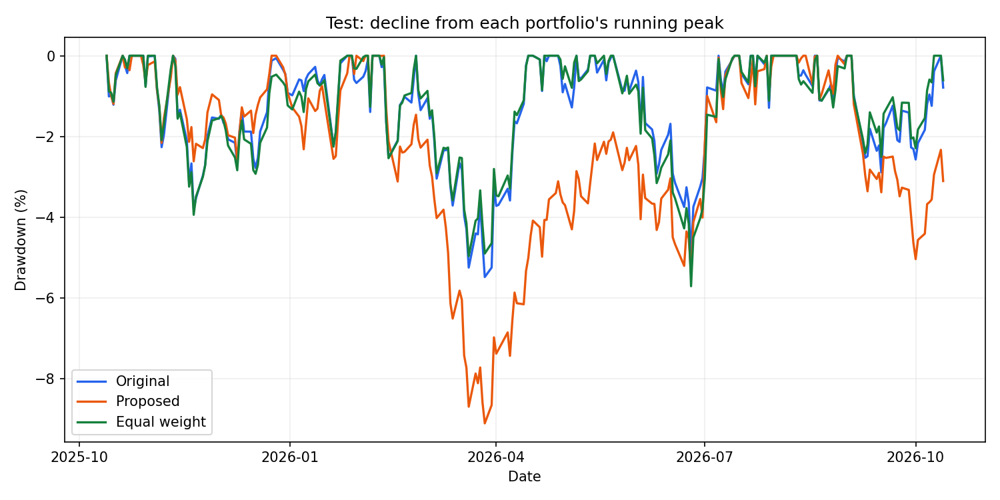
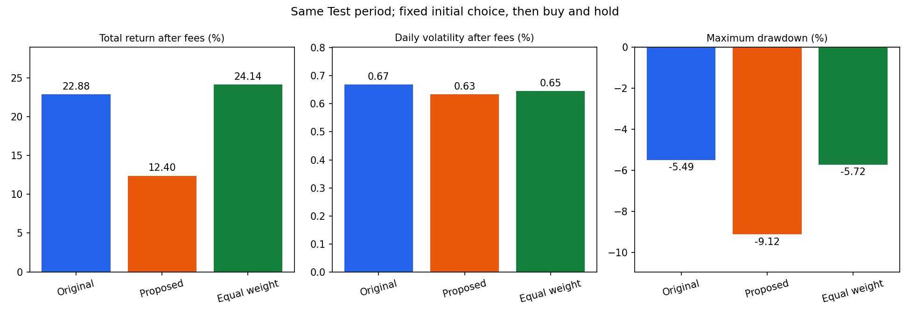

# LongTripleTun — สรุปพอร์ตของคุณ

**สร้างรายงาน:** 16/10/2026 01:08:02 (เวลาไทย UTC+7)

**ไฟล์พอร์ตที่ใช้:** `C:\kmitl\Year2\T1\linear\project\Linears\longtripletun\example_portfolios\02_multi_sector.csv`

## พอร์ตตั้งต้นของคุณ

| หุ้น | สัดส่วนลงทุน (%) |
|---|---:|
| NVDA | 15.00 |
| MSFT | 15.00 |
| AAPL | 10.00 |
| AMZN | 10.00 |
| JPM | 15.00 |
| JNJ | 15.00 |
| PG | 10.00 |
| XOM | 10.00 |
| **รวม** | **100.00** |

เป็นสัดส่วนที่กรอกก่อนปรับพอร์ต ไม่ใช่น้ำหนักที่เปลี่ยนตามราคาตอนสิ้นสุดการทดสอบ

**คงพอร์ตเดิม**

ยังไม่พบทางเลือกที่ลดการแกว่งได้เพียงพอ โดยรักษาผลตอบแทนและการลดลงจากยอดให้อยู่ในเกณฑ์ที่กำหนด

ช่วงที่เปรียบเทียบผล: **2025-10-14 ถึง 2026-10-13**

## ภาพรวมพอร์ต

ถือหุ้น 8 ตัว โดย JNJ มีสัดส่วนมากที่สุด **15%** และสามอันดับแรกรวม **45%** ของพอร์ต

## ทางเลือกที่ผ่านเกณฑ์

**ไม่มี — คงสัดส่วนเดิมและไม่เสียค่าปรับพอร์ตเพิ่มในแบบจำลองนี้**

## เปรียบเทียบทางเลือกเดิมเพื่อให้เห็นสิ่งที่ต้องแลก

**ตารางและกราฟส่วนนี้เป็นการเปรียบเทียบ ไม่ใช่คำแนะนำให้ซื้อ** ระดับต่ำ–สูงเรียงตามการแกว่งที่ประมาณก่อนทดสอบ และเป็นคนละชุดกับทางเลือกที่ผ่านเกณฑ์ด้านบน

| พอร์ต | ผลตอบแทนสุทธิ ก่อน → หลัง % | ความผันผวนรายวัน ก่อน → หลัง % | Max Drawdown % |
|---|---:|---:|---:|
| พอร์ตเดิม | 22.88 → 22.88 | 0.6686 → 0.6686 | -5.49 |
| ระดับ 1 (ต่ำ) | 22.88 → 12.40 | 0.6686 → 0.6342 | -9.12 |
| ระดับ 2 (กลาง) | 22.88 → 17.64 | 0.6686 → 0.6323 | -7.14 |
| ระดับ 3 (สูง) | 22.88 → 20.26 | 0.6686 → 0.6462 | -6.23 |
| แบ่งเท่ากัน | 22.88 → 24.14 | 0.6686 → 0.6460 | -5.72 |

- **ระดับ 1 (ต่ำ):** การแกว่งรายวันลดลงประมาณ 5.15%; กำไรสะสมลดลงประมาณ 45.83% เมื่อเทียบกับกำไรเดิม
- **ระดับ 2 (กลาง):** การแกว่งรายวันลดลงประมาณ 5.44%; กำไรสะสมลดลงประมาณ 22.92% เมื่อเทียบกับกำไรเดิม
- **ระดับ 3 (สูง):** การแกว่งรายวันลดลงประมาณ 3.36%; กำไรสะสมลดลงประมาณ 11.46% เมื่อเทียบกับกำไรเดิม

## ถ้าเริ่มด้วยเงิน 100,000 หน่วย

| พอร์ต | กำไร/ขาดทุน | ต่างจากพอร์ตเดิม | เงินปลายช่วง |
|---|---:|---:|---:|
| พอร์ตเดิม | 22,883.46 | 0.00 | 122,883.46 |
| ระดับ 1 (ต่ำ) | 12,395.14 | -10,488.32 | 112,395.14 |
| ระดับ 2 (กลาง) | 17,638.25 | -5,245.21 | 117,638.25 |
| ระดับ 3 (สูง) | 20,260.59 | -2,622.86 | 120,260.59 |
| แบ่งเท่ากัน | 24,136.86 | 1,253.40 | 124,136.86 |

## กราฟเปรียบเทียบ

Original = พอร์ตเดิม · Proposed = ทางเลือกเดิมที่ประมาณการแกว่งต่ำสุด (เพื่อเปรียบเทียบ) · Equal weight = แบ่งเงินเท่ากันในหุ้นเดิม

### มูลค่าพอร์ต เริ่มต้นที่ 100

### การลดลงจากจุดสูงสุด

### ผลตอบแทนและความเสี่ยง

## อ่านตัวเลขอย่างไร

- ผลตอบแทนสุทธิ: กำไรหรือขาดทุนตลอดช่วงที่ระบุ หลังค่าธรรมเนียมสมมติ ไม่ใช่ผลตอบแทนต่อปี
- ความผันผวนรายวัน: ขนาดการแกว่งของผลตอบแทน ค่าน้อยไม่ได้แปลว่ากำไรมากหรือขาดทุนน้อยเสมอ
- Max Drawdown: เคยลดจากยอดก่อนหน้าหนักที่สุดเท่าไร เช่น −20% คือจากยอด 100 เหลือ 80 ไม่ใช่โอกาสขาดทุน 20%
- ค่าธรรมเนียมสมมติ 0.10% ต่อมูลค่าซื้อหรือขาย ไม่รวมภาษีและอัตราแลกเปลี่ยน
- ข้อมูลไม่ครบหมายถึงประเมินไม่ได้ ไม่ใช่ผลเป็นศูนย์ ผลย้อนหลังไม่รับประกันผลในอนาคต
